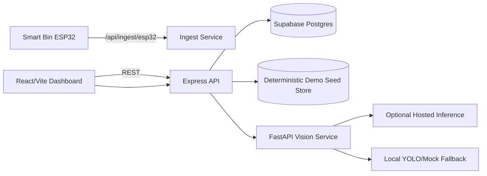

# SIH26259 Demo Guide — Zer0wasteX

## 1) Architecture



## 2) Environment & Setup

### Backend
- `DEMO_MODE=true` for deterministic local mode
- `DEMO_MODE=false` + Supabase credentials for production mode
- `CORS_ORIGINS` comma-separated explicit list

### Frontend
- `VITE_API_BASE_URL` backend base URL
- legacy Supabase variables retained for older pages

### ML Vision
- `VISION_MODEL_SOURCE=auto|hosted|local|mock`
- `VISION_SKIP_MODEL_INIT=true` for smoke/CI
- optional `HOSTED_INFERENCE_URL`, `HOSTED_INFERENCE_TOKEN`

## 3) SIH Feature Mapping

### MRF Dashboard
- Daily intake, throughput, recovered material, contamination rate, storage, dispatch count, pending collections, alerts.

### MLP Taxonomy
- `plastic_general`, `mlp_sachet`, `mlp_laminated_pouch`, `mlp_wrapper`, `mlp_polybag`, `mlp_contaminated`.
- Heuristic/demo labels are explicitly marked.

### Smart Bin Collection
- Existing fill and weight retained.
- Added: `collection_status`, `pickup_assignment`, `route_code`, `route_priority`, `alert_state`.

### Workflow & Audit
- Stages: `intake -> sorting -> quality_inspection -> baling_storage -> recycler_dispatch`.
- Audit log tracks status/stage transitions and actor notes.

### Citizen/Operator Reporting
- Drop events maintained.
- New operator inspection records: location, weight, contamination, image URL, notes.

## 4) API Reference (Backend)

### GET `/api/dashboard/overview`
Response includes:
- `metrics.daily_intake_kg`
- `metrics.throughput_kg`
- `metrics.recovered_material_kg`
- `metrics.contamination_rejection_rate`
- `metrics.storage_utilization_percent`
- `metrics.recycler_dispatch_count`
- `metrics.pending_collections`
- `metrics.open_alerts`

### GET `/api/material-taxonomy`
Returns MLP/plastic classes and heuristic/demo source labels.

### PATCH `/api/bins/:id/collection`
Payload:
```json
{
  "collection_status": "pending",
  "pickup_assignment": "truck-a1",
  "route_code": "CHN-SOUTH-02",
  "route_priority": "high",
  "alert_state": "critical"
}
```

### GET/POST `/api/workflow/records`
Create payload:
```json
{
  "intake_date": "2026-10-20",
  "source_bin_id": "...",
  "stage": "intake",
  "status": "in_progress",
  "weight_kg": 120,
  "contamination_rate": 12,
  "recovered_material_kg": 0,
  "mlp_taxonomy": ["mlp_wrapper"],
  "notes": "mixed wrappers"
}
```

### PATCH `/api/workflow/records/:id/status`
```json
{
  "stage": "baling_storage",
  "status": "in_progress",
  "actor": "operator_1",
  "remarks": "moved after QA"
}
```

### GET `/api/workflow/records/:id/audit`
Returns chronological audit history for a workflow record.

### GET/POST `/api/inspections`
Create payload:
```json
{
  "operator_name": "operator_uma",
  "location_name": "PWMU Zone A",
  "location_lat": 13.0827,
  "location_lng": 80.2707,
  "material_type": "mlp_laminated_pouch",
  "weight_kg": 14.2,
  "contamination_percent": 18,
  "image_url": "https://...",
  "notes": "residue present"
}
```

## 5) Vision Service API

### GET `/health`
Shows runtime layer and model adapter status.

### GET `/classes`
Returns primary classes + MLP taxonomy metadata.

### POST `/score`
- Input multipart `file` (image) + optional `bin_type` query.
- Output includes confidence, quality score, `model_source`, and `mlp_category` with heuristic flag.

## 6) Model & License Notes

- Local fallback uses YOLO-compatible path (`best.pt` when available, otherwise fallback).
- Hosted inference is optional and configured through environment variables only.
- No model weights or credentials are committed.
- Accuracy claims for MLP sub-classes are intentionally conservative (heuristic/demo where applicable).

## 7) Limitations

1. MLP subtype detection is primarily heuristic/demo unless trained domain-specific model is provided.
2. Demo mode is seeded simulation and does not represent live municipal telemetry.
3. Hosted inference contract is generic; integrate provider-specific payload mapping as needed.

## 8) Video Recording Checklist

- [ ] Show backend startup in `DEMO_MODE=true`.
- [ ] Show frontend dashboard metrics and MRF workflow board.
- [ ] Update a workflow stage and show audit history update.
- [ ] Update a bin collection status and show priority/alert changes.
- [ ] Create an inspection record and verify list refresh.
- [ ] Call vision `/health`, `/classes`, and `/score` with model source visible.
- [ ] Run `./scripts/validate_demo.sh` and show outputs.
- [ ] Generate submission ZIP with `./scripts/package_submission.sh`.
